# Relatório OA2 — Modelagem da Solução Computacional

Equipe do Projeto 3 · versão de 30/09/2026

## Capa

| Campo | Valor |
| --- | --- |
| Instituição | Fundação Matias Machline |
| Curso | Engenharia da Computação |
| Disciplina | Ambiente Fabril I |
| Projeto | Projeto Integrador — AMATECH Smart Factory |
| Título | Dashboard Industrial (Projeto 3) — Problema 8: Indicadores dispersos |
| Etapa | OA2 — Modelagem da Solução Computacional |
| Integrantes | Letícia (Líder), Vinicius (Analista de Processos), Mateus (Desenvolvedor), Radier (Desenvolvedor de Interface), Jose Orlando (Testes e Documentação) |
| Professor | \[preencher\] |
| Cidade / Ano | Manaus / 2026 |

## Sumário

1. Introdução
2. Revisão dos requisitos
3. Modelagem de dados
4. Diagrama de Casos de Uso
5. Diagrama de Classes
6. Fluxo do sistema
7. Arquitetura
8. Wireframes finais
9. Planejamento do desenvolvimento
10. Matriz de rastreabilidade
11. Considerações da etapa
12. Referências

## 1. Introdução

A OA2 define como o Dashboard Industrial vai resolver o Problema 8: um banco único, alimentado por formulários e planilhas, com indicadores calculados na consulta e exibidos em um painel com semáforo. Esta etapa responde à pergunta "Como o sistema irá resolver o problema?", a partir do diagnóstico e dos requisitos levantados na OA1.

Na OA1, a equipe identificou que os indicadores de produção, qualidade, manutenção e perdas da AMATECH ficam em arquivos separados e são consolidados manualmente ao final do turno. Por isso, problemas do início do turno podem levar horas para serem percebidos. A proposta TO-BE da OA1 foi registrar os eventos no momento em que ocorrem, armazená-los em um banco único e calcular os indicadores automaticamente.

A OA2 foi construída em oito etapas, na ordem das dependências entre elas. Cada etapa foi revisada e aprovada pela equipe antes do início da seguinte:

| Etapa | Entregável | Seção |
| --- | --- | --- |
| 1. Decisões de base | Revisão dos requisitos e dos indicadores | 2 |
| 2. Modelo de dados | MER com 17 tabelas e dicionário de dados | 3 |
| 3. Casos de uso | Diagrama com 7 atores e 16 casos de uso | 4 |
| 4. Classes | Diagrama com 7 classes de serviço e 13 classes de dados | 5 |
| 5. Fluxo do sistema | Fluxograma com 3 raias e 4 decisões | 6 |
| 6. Arquitetura | Arquitetura em 4 camadas, tecnologias e estrutura de pastas | 7 |
| 7. Wireframes | 10 telas do sistema | 8 |
| 8. Planejamento | Cronograma da OA3 em 5 sprints e divisão da equipe | 9 |

Todos os diagramas foram entregues também em arquivos .drawio editáveis, e o modelo de dados foi validado em um script SQL executado no SQLite.

## 2. Revisão dos requisitos

A OA2 acrescenta cinco requisitos funcionais, um não funcional e quatro regras de negócio aos da OA1, e corrige dois indicadores. As lacunas surgiram ao comparar os requisitos da OA1 com o Problema 8, que cita produção, qualidade, manutenção **e perdas** em arquivos separados. Os requisitos RF01 a RF14, RNF01 a RNF06 e RN01 a RN05 da OA1 continuam válidos.

### 2.1 Novos requisitos funcionais

| ID | Requisito | Origem | Prioridade |
| --- | --- | --- | --- |
| RF15 | Cadastrar perdas (tipo, quantidade, estação, data, turno e produto) | Problema 8; causa C04 da OA1 | Alta |
| RF16 | Importar dados de produção, defeitos, paradas e perdas a partir de planilhas CSV, com validação e relatório das linhas rejeitadas | Problema 8; OM03; causa C01 | Alta |
| RF17 | Exibir alerta visual (semáforo verde, amarelo e vermelho) quando um indicador estiver fora da faixa esperada | Seção 9.2 da OA1; elemento 12 do TO-BE | Média |
| RF18 | Autenticar usuários por login e senha | Vários atores lançam dados (seção 3.3 da OA1) | Alta |
| RF19 | Gerenciar usuários e perfis de acesso | Complemento do RF18 | Média |

O RF17 já estava previsto no processo TO-BE da OA1: o elemento 12 é a decisão "Indicador fora do esperado?". Faltava apenas o requisito correspondente.

### 2.2 Novo requisito não funcional

| ID | Requisito | Categoria | Justificativa |
| --- | --- | --- | --- |
| RNF07 | Senhas armazenadas apenas como hash; cada perfil acessa somente as funções autorizadas | Segurança | Protege a confiabilidade dos registros (RNF04) |

### 2.3 Novas regras de negócio

| ID | Regra | Requisito relacionado |
| --- | --- | --- |
| RN06 | Uma importação com qualquer linha inválida não grava nada: o arquivo é recusado e as linhas com erro são listadas | RF16, RNF04 |
| RN07 | Toda perda deve ter tipo e quantidade maior que zero | RF15 |
| RN08 | Os limites do semáforo são parâmetros configuráveis, ajustados pela supervisão sem alterar o código | RF17 |
| RN09 | Existe no máximo uma meta por combinação de data, turno e produto | RF02, RF06 |

### 2.4 Ajustes nos indicadores da OA1

Na seção 9.3 da OA1, "Produtividade" e "Atendimento da meta" tinham a mesma fórmula e mostrariam sempre o mesmo número. A produtividade passa a medir notebooks produzidos por hora efetiva de trabalho, descontando as paradas:

```latex
\text{Produtividade} = \frac{\text{Produção realizada}}{\text{Duração do turno (h)} - \text{Tempo de parada (h)}} \quad [\text{unid/h}]
```

A meta passa a ser cadastrada por data, turno e produto (RN09), e não apenas por data e produto. Isso permite calcular o atendimento da meta por turno, previsto na seção 9.3 da OA1. Com os ajustes, o painel exibe seis indicadores:

| Indicador | Fórmula | Unidade | Exemplo com os dados do enunciado |
| --- | --- | --- | --- |
| Atendimento da meta | (Produção realizada ÷ Meta do turno) × 100 | % | 1.420 ÷ 1.500 = 94,7% |
| Produtividade | Produção realizada ÷ horas efetivas | unid/h | 1.420 ÷ (480 − 85 min) = 215,7 unid/h |
| Índice de defeitos | (Reprovados ÷ Produção realizada) × 100 | % | 60 ÷ 1.420 = 4,2% |
| Índice de retrabalho | (Quantidade em retrabalho ÷ Produção realizada) × 100 | % | 30 ÷ 1.420 = 2,1% |
| Tempo de parada | Soma das durações das paradas no período | min | 85 min |
| Perdas | Soma das quantidades perdidas no período, por tipo | unid | 8 unidades |

A duração de 480 minutos por turno, o retrabalho de 30 unidades e a perda de 8 unidades são dados simulados pela equipe, como permite o item 2.8 do enunciado.

### 2.5 Limites do semáforo

Três indicadores recebem o semáforo. Os limites iniciais são propostas da equipe e podem ser ajustados pelo Supervisor (RN08):

| Indicador | Verde | Amarelo | Vermelho |
| --- | --- | --- | --- |
| Atendimento da meta | 95% ou mais | de 75% a 95% | abaixo de 75% |
| Índice de defeitos | até 2% | de 2% a 5% | acima de 5% |
| Índice de retrabalho | até 2% | de 2% a 5% | acima de 5% |

Com os dados do enunciado, os três indicadores ficam amarelos: 94,7% de atendimento, 4,2% de defeitos e 2,1% de retrabalho. Produtividade, tempo de parada e perdas são exibidos sem cor, pois não têm limites definidos.

## 3. Modelagem de dados

O banco de dados tem 17 tabelas em SQLite, organizadas em quatro grupos, e todos os relacionamentos são do tipo um-para-muitos (1:N). Os indicadores não são guardados em colunas: são calculados no momento da consulta pela classe CalculadoraIndicadores (seção 5), o que evita valores desatualizados.

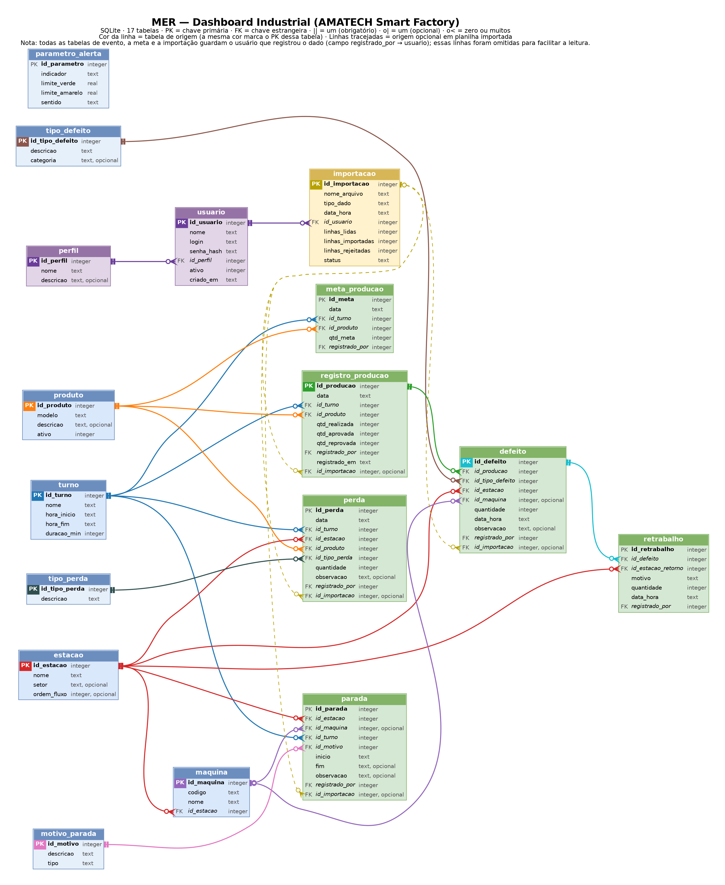

**Figura 3.1 — Modelo Entidade-Relacionamento.** A cor de cada linha é a cor da tabela de origem, a mesma que marca o seu PK. Linhas tracejadas indicam origem opcional em planilha importada. As ligações "registrado\_por" (de cada evento para o usuário) foram omitidas do desenho para facilitar a leitura.

### 3.1 Grupos de tabelas

| Grupo | Tabelas | Papel |
| --- | --- | --- |
| Onde e quando | turno, produto, estacao, maquina | Cadastros básicos que os eventos referenciam |
| Tipos padronizados | tipo\_defeito, motivo\_parada, tipo\_perda, parametro\_alerta | Listas de opções que evitam textos digitados livremente (OM04) |
| Eventos da linha | meta\_producao, registro\_producao, defeito, retrabalho, parada, perda | O que acontece na produção ao longo do turno |
| Acesso e importação | perfil, usuario, importacao | Quem registra os dados e de qual planilha eles vieram |

### 3.2 Relacionamentos

| Tabela "um" | Tabela "muitos" | Significado |
| --- | --- | --- |
| perfil | usuario | Cada usuário tem um perfil |
| usuario | importacao e todas as tabelas de evento | Cada registro guarda quem o lançou |
| turno | meta\_producao, registro\_producao, parada, perda | Todo evento acontece em um turno (RN01) |
| produto | meta\_producao, registro\_producao, perda | Todo evento de produção se refere a um modelo (RN01) |
| estacao | maquina, defeito, parada, perda | Onde o evento aconteceu |
| estacao | retrabalho | Estação para onde o produto retorna (RN02) |
| maquina | defeito, parada | Máquina envolvida, quando houver (opcional) |
| registro\_producao | defeito | Um registro de produção pode ter vários defeitos |
| defeito | retrabalho | Um defeito pode gerar retrabalho |
| tipo\_defeito, motivo\_parada, tipo\_perda | defeito, parada, perda | Padronizam as descrições |
| importacao | registro\_producao, defeito, parada, perda | Planilha de origem do dado (opcional) |

Três decisões da modelagem merecem destaque. O registro de produção **não tem estação**, porque o mesmo notebook passa por todas elas e seria contado várias vezes; a estação aparece nos defeitos, nas paradas e nas perdas. A soma dos defeitos **não precisa ser igual** ao número de reprovados, porque um notebook pode ter mais de um defeito: o índice de defeitos usa os reprovados, e a tabela de defeitos mostra onde e quais problemas ocorreram. A duração da parada **é calculada** a partir do início e do fim, e uma parada pode ficar em andamento, com o fim vazio.

### 3.3 Dicionário de dados

PK = chave primária; FK = chave estrangeira, seguida da tabela referenciada.

**3.3.1 turno** — Turnos de trabalho

| Campo | Tipo | Chave | Obrigatório | Descrição |
| --- | --- | --- | --- | --- |
| id\_turno | INTEGER | PK | Sim | Identificador |
| nome | TEXT |  | Sim | Nome do turno (ex.: 1º turno) |
| hora\_inicio | TEXT |  | Sim | Hora de início (HH:MM) |
| hora\_fim | TEXT |  | Sim | Hora de fim (HH:MM) |
| duracao\_min | INTEGER |  | Sim | Duração em minutos, usada na produtividade |

**3.3.2 produto** — Modelos de notebook

| Campo | Tipo | Chave | Obrigatório | Descrição |
| --- | --- | --- | --- | --- |
| id\_produto | INTEGER | PK | Sim | Identificador |
| modelo | TEXT |  | Sim | Nome do modelo, único |
| descricao | TEXT |  | Não | Descrição do modelo |
| ativo | INTEGER |  | Sim | 1 = em produção, 0 = fora de linha |

**3.3.3 estacao** — Etapas da linha de produção

| Campo | Tipo | Chave | Obrigatório | Descrição |
| --- | --- | --- | --- | --- |
| id\_estacao | INTEGER | PK | Sim | Identificador |
| nome | TEXT |  | Sim | Nome da estação (ex.: Teste funcional) |
| setor | TEXT |  | Não | Setor (Produção, Qualidade, Expedição) |
| ordem\_fluxo | INTEGER |  | Não | Posição da estação no fluxo produtivo |

**3.3.4 maquina** — Equipamentos das estações

| Campo | Tipo | Chave | Obrigatório | Descrição |
| --- | --- | --- | --- | --- |
| id\_maquina | INTEGER | PK | Sim | Identificador |
| codigo | TEXT |  | Sim | Código do equipamento, único (ex.: TST-02) |
| nome | TEXT |  | Sim | Nome do equipamento |
| id\_estacao | INTEGER | FK → estacao | Sim | Estação onde a máquina fica |

**3.3.5 tipo\_defeito** — Lista padronizada de defeitos

| Campo | Tipo | Chave | Obrigatório | Descrição |
| --- | --- | --- | --- | --- |
| id\_tipo\_defeito | INTEGER | PK | Sim | Identificador |
| descricao | TEXT |  | Sim | Nome do defeito (ex.: Falha no teclado) |
| categoria | TEXT |  | Não | Funcional, visual ou documental |

**3.3.6 motivo\_parada** — Lista padronizada de motivos de parada

| Campo | Tipo | Chave | Obrigatório | Descrição |
| --- | --- | --- | --- | --- |
| id\_motivo | INTEGER | PK | Sim | Identificador |
| descricao | TEXT |  | Sim | Motivo (ex.: Falha de equipamento) |
| tipo | TEXT |  | Sim | Corretiva, preventiva ou operacional |

**3.3.7 tipo\_perda** — Lista padronizada de tipos de perda

| Campo | Tipo | Chave | Obrigatório | Descrição |
| --- | --- | --- | --- | --- |
| id\_tipo\_perda | INTEGER | PK | Sim | Identificador |
| descricao | TEXT |  | Sim | Tipo (ex.: Componente danificado) |

**3.3.8 parametro\_alerta** — Limites configuráveis do semáforo (RN08)

| Campo | Tipo | Chave | Obrigatório | Descrição |
| --- | --- | --- | --- | --- |
| id\_parametro | INTEGER | PK | Sim | Identificador |
| indicador | TEXT |  | Sim | Indicador ao qual o limite se aplica |
| limite\_verde | REAL |  | Sim | Valor a partir do qual o indicador fica verde |
| limite\_amarelo | REAL |  | Sim | Valor a partir do qual o indicador fica amarelo |
| sentido | TEXT |  | Sim | maior\_melhor ou menor\_melhor |

**3.3.9 meta\_producao** — Meta planejada por dia, turno e produto (RF02, RN09)

| Campo | Tipo | Chave | Obrigatório | Descrição |
| --- | --- | --- | --- | --- |
| id\_meta | INTEGER | PK | Sim | Identificador |
| data | TEXT |  | Sim | Data da meta (AAAA-MM-DD) |
| id\_turno | INTEGER | FK → turno | Sim | Turno |
| id\_produto | INTEGER | FK → produto | Sim | Produto |
| qtd\_meta | INTEGER |  | Sim | Quantidade planejada, maior que zero |
| registrado\_por | INTEGER | FK → usuario | Sim | Usuário que cadastrou |

**3.3.10 registro\_producao** — Produção realizada (RF01)

| Campo | Tipo | Chave | Obrigatório | Descrição |
| --- | --- | --- | --- | --- |
| id\_producao | INTEGER | PK | Sim | Identificador |
| data | TEXT |  | Sim | Data da produção |
| id\_turno | INTEGER | FK → turno | Sim | Turno |
| id\_produto | INTEGER | FK → produto | Sim | Produto |
| qtd\_realizada | INTEGER |  | Sim | Quantidade produzida |
| qtd\_aprovada | INTEGER |  | Sim | Quantidade aprovada na inspeção |
| qtd\_reprovada | INTEGER |  | Sim | Quantidade reprovada |
| registrado\_por | INTEGER | FK → usuario | Sim | Usuário que lançou |
| registrado\_em | TEXT |  | Sim | Data e hora do lançamento |
| id\_importacao | INTEGER | FK → importacao | Não | Planilha de origem; vazio = formulário |

**3.3.11 defeito** — Defeitos encontrados (RF03)

| Campo | Tipo | Chave | Obrigatório | Descrição |
| --- | --- | --- | --- | --- |
| id\_defeito | INTEGER | PK | Sim | Identificador |
| id\_producao | INTEGER | FK → registro\_producao | Sim | Registro de produção de origem |
| id\_tipo\_defeito | INTEGER | FK → tipo\_defeito | Sim | Tipo do defeito |
| id\_estacao | INTEGER | FK → estacao | Sim | Estação onde foi encontrado |
| id\_maquina | INTEGER | FK → maquina | Não | Máquina envolvida, se houver |
| quantidade | INTEGER |  | Sim | Quantidade de unidades, maior que zero |
| data\_hora | TEXT |  | Sim | Data e hora da ocorrência |
| observacao | TEXT |  | Não | Observação livre |
| registrado\_por | INTEGER | FK → usuario | Sim | Usuário que lançou |
| id\_importacao | INTEGER | FK → importacao | Não | Planilha de origem; vazio = formulário |

**3.3.12 retrabalho** — Consertos de defeitos (RF04, RN02)

| Campo | Tipo | Chave | Obrigatório | Descrição |
| --- | --- | --- | --- | --- |
| id\_retrabalho | INTEGER | PK | Sim | Identificador |
| id\_defeito | INTEGER | FK → defeito | Sim | Defeito que gerou o retrabalho |
| id\_estacao\_retorno | INTEGER | FK → estacao | Sim | Estação para onde o produto voltou |
| motivo | TEXT |  | Sim | Motivo do retrabalho |
| quantidade | INTEGER |  | Sim | Quantidade retrabalhada, maior que zero |
| data\_hora | TEXT |  | Sim | Data e hora do retrabalho |
| registrado\_por | INTEGER | FK → usuario | Sim | Usuário que lançou |

**3.3.13 parada** — Paradas de linha ou de máquina (RF05, RN04)

| Campo | Tipo | Chave | Obrigatório | Descrição |
| --- | --- | --- | --- | --- |
| id\_parada | INTEGER | PK | Sim | Identificador |
| id\_estacao | INTEGER | FK → estacao | Sim | Estação parada |
| id\_maquina | INTEGER | FK → maquina | Não | Máquina parada, se houver |
| id\_turno | INTEGER | FK → turno | Sim | Turno |
| id\_motivo | INTEGER | FK → motivo\_parada | Sim | Motivo da parada, obrigatório |
| inicio | TEXT |  | Sim | Data e hora de início |
| fim | TEXT |  | Não | Data e hora de fim; vazio = parada em andamento |
| observacao | TEXT |  | Não | Observação livre |
| registrado\_por | INTEGER | FK → usuario | Sim | Usuário que lançou |
| id\_importacao | INTEGER | FK → importacao | Não | Planilha de origem; vazio = formulário |

**3.3.14 perda** — Material ou produto perdido (RF15, RN07)

| Campo | Tipo | Chave | Obrigatório | Descrição |
| --- | --- | --- | --- | --- |
| id\_perda | INTEGER | PK | Sim | Identificador |
| data | TEXT |  | Sim | Data da perda |
| id\_turno | INTEGER | FK → turno | Sim | Turno |
| id\_estacao | INTEGER | FK → estacao | Sim | Estação |
| id\_produto | INTEGER | FK → produto | Sim | Produto |
| id\_tipo\_perda | INTEGER | FK → tipo\_perda | Sim | Tipo de perda, obrigatório |
| quantidade | INTEGER |  | Sim | Quantidade perdida, maior que zero |
| observacao | TEXT |  | Não | Observação livre |
| registrado\_por | INTEGER | FK → usuario | Sim | Usuário que lançou |
| id\_importacao | INTEGER | FK → importacao | Não | Planilha de origem; vazio = formulário |

**3.3.15 perfil** — Tipos de usuário do sistema

| Campo | Tipo | Chave | Obrigatório | Descrição |
| --- | --- | --- | --- | --- |
| id\_perfil | INTEGER | PK | Sim | Identificador |
| nome | TEXT |  | Sim | Nome do perfil (ex.: Supervisor de produção) |
| descricao | TEXT |  | Não | O que o perfil pode fazer |

**3.3.16 usuario** — Pessoas que acessam o sistema

| Campo | Tipo | Chave | Obrigatório | Descrição |
| --- | --- | --- | --- | --- |
| id\_usuario | INTEGER | PK | Sim | Identificador |
| nome | TEXT |  | Sim | Nome completo |
| login | TEXT |  | Sim | Login de acesso, único |
| senha\_hash | TEXT |  | Sim | Senha protegida por hash (RNF07) |
| id\_perfil | INTEGER | FK → perfil | Sim | Perfil do usuário |
| ativo | INTEGER |  | Sim | 1 = ativo, 0 = desativado (usuários não são apagados) |
| criado\_em | TEXT |  | Sim | Data e hora de criação |

**3.3.17 importacao** — Histórico de planilhas importadas (RF16)

| Campo | Tipo | Chave | Obrigatório | Descrição |
| --- | --- | --- | --- | --- |
| id\_importacao | INTEGER | PK | Sim | Identificador |
| nome\_arquivo | TEXT |  | Sim | Nome do arquivo CSV |
| tipo\_dado | TEXT |  | Sim | Produção, defeito, parada ou perda |
| data\_hora | TEXT |  | Sim | Data e hora da importação |
| id\_usuario | INTEGER | FK → usuario | Sim | Usuário que enviou o arquivo |
| linhas\_lidas | INTEGER |  | Sim | Total de linhas do arquivo |
| linhas\_importadas | INTEGER |  | Sim | Linhas gravadas |
| linhas\_rejeitadas | INTEGER |  | Sim | Linhas com erro |
| status | TEXT |  | Sim | Concluída ou rejeitada |

### 3.4 Regras de negócio garantidas pelo banco

Parte das regras é garantida pelo próprio SQLite, e não apenas pelo código. Assim, nem um erro de programação consegue gravar um dado que viole essas regras. As restrições foram testadas no script SQL com dados inválidos, e todas foram recusadas.

| Regra | Restrição no banco | Teste realizado |
| --- | --- | --- |
| RN01 | Data, turno e produto obrigatórios, com chaves estrangeiras | Registro com turno inexistente: recusado |
| RN02 | Retrabalho exige estação de retorno e motivo | Retrabalho sem estação ou sem motivo: recusado |
| RN04 | Motivo obrigatório em toda parada | Parada sem motivo: recusada |
| RN07 | Tipo obrigatório e quantidade maior que zero em toda perda | Perda com quantidade zero: recusada |
| RN09 | Combinação de data, turno e produto única na meta | Meta duplicada: recusada |
| RNF04 | Aprovados + reprovados = produzidos; fim da parada depois do início | Conta que não fecha e horário invertido: recusados |

As regras RN03 (atendimento só com meta cadastrada), RN05 (indicadores sempre por período), RN06 (importação tudo ou nada) e RN08 (limites configuráveis) são garantidas pelas classes de serviço, descritas na seção 5.

## 4. Diagrama de Casos de Uso

O sistema tem 7 atores e 16 casos de uso, e cada requisito funcional está ligado a pelo menos um deles (seção 10). Os atores vêm da seção 3.3 da OA1, com o acréscimo do Administrador, necessário a partir do login e dos perfis.

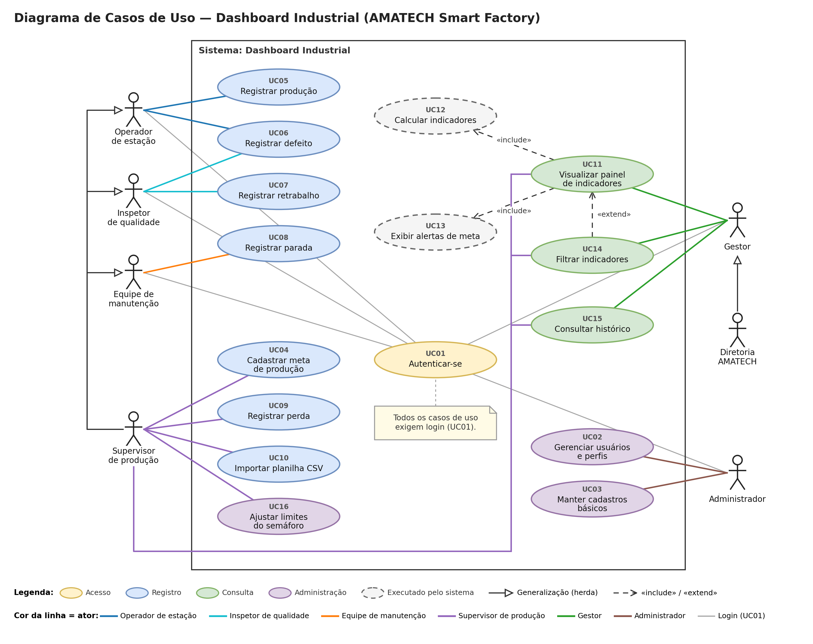

**Figura 4.1 — Diagrama de Casos de Uso.** A cor da elipse indica o grupo do caso, e a cor da linha indica o ator. Casos com borda tracejada são executados pelo próprio sistema.

### 4.1 Atores

| Ator | Quem é | Origem |
| --- | --- | --- |
| Operador de estação | Quem trabalha nas etapas da linha | OA1, seção 3.3 |
| Inspetor de qualidade | Quem faz a inspeção funcional, visual e documental | OA1, seção 3.3 |
| Equipe de manutenção | Quem registra e resolve as paradas | OA1, seção 3.3 |
| Supervisor de produção | Quem acompanha o turno, lança e importa dados | OA1, seção 3.3 (Gestores/Supervisão) |
| Gestor | Quem analisa os indicadores para decidir | OA1, seção 3.3 (Gestores/Supervisão) |
| Diretoria AMATECH | A alta gestão da fábrica | OA1, seção 3.3 |
| Administrador | Quem gerencia usuários e cadastros | Novo, a partir do RF18 e do RF19 |

Na OA1, "Gestores/Supervisão" era um único ator. Ele foi separado em Supervisor e Gestor porque, no sistema, o primeiro lança e importa dados, enquanto o segundo apenas consulta.

### 4.2 Casos de uso

| ID | Caso de uso | Ator principal | Requisitos |
| --- | --- | --- | --- |
| UC01 | Autenticar-se | Todos | RF18 |
| UC02 | Gerenciar usuários e perfis | Administrador | RF19 |
| UC03 | Manter cadastros básicos | Administrador | Apoio a RF01–RF05 e RF15 |
| UC04 | Cadastrar meta de produção | Supervisor | RF02 |
| UC05 | Registrar produção | Operador | RF01 |
| UC06 | Registrar defeito | Operador, Inspetor | RF03 |
| UC07 | Registrar retrabalho | Inspetor | RF04 |
| UC08 | Registrar parada | Manutenção | RF05 |
| UC09 | Registrar perda | Supervisor | RF15 |
| UC10 | Importar planilha CSV | Supervisor | RF16 |
| UC11 | Visualizar painel de indicadores | Supervisor, Gestor | RF10, RF11 |
| UC12 | Calcular indicadores | Sistema (incluído em UC11) | RF06–RF09 |
| UC13 | Exibir alertas de meta | Sistema (incluído em UC11) | RF17 |
| UC14 | Filtrar indicadores | Supervisor, Gestor | RF12 |
| UC15 | Consultar histórico | Supervisor, Gestor | RF13 |
| UC16 | Ajustar limites do semáforo | Supervisor | RF17, RN08 |

O RF14 (navegação entre telas) não é um caso de uso, porque não é uma função que alguém executa, e sim uma característica da interface. Ele é atendido pelo menu lateral das telas (seção 8).

### 4.3 Relações

| Relação | Tipo | Significado |
| --- | --- | --- |
| Supervisor → Operador, Inspetor e Manutenção | Generalização | O Supervisor pode fazer tudo o que esses três atores fazem |
| Diretoria → Gestor | Generalização | A Diretoria pode fazer tudo o que o Gestor faz |
| UC11 → UC12 | «include» | Toda vez que o painel abre, os indicadores são calculados |
| UC11 → UC13 | «include» | Toda vez que o painel abre, as cores do semáforo são aplicadas |
| UC14 → UC11 | «extend» | Filtrar é opcional: o painel abre com o dia e o turno atuais |
| UC01 e os atores de base | Associação + nota | Todos os casos exigem login; o login é condição de entrada, e não parte de cada função |

As generalizações substituem várias linhas que cruzariam o diagrama. O login foi representado por associação e nota, em vez de um «include» de cada caso para o UC01, pelo mesmo motivo.

### 4.4 Descrição dos casos de uso principais

**UC05 — Registrar produção**

- **Ator:** Operador de estação (ou Supervisor, por herança).
- **Pré-condição:** usuário autenticado (UC01).
- **Fluxo principal:**
  1. O ator abre a tela Produção e metas; data e turno já vêm preenchidos pelo relógio.
  2. Informa o produto e as quantidades realizada, aprovada e reprovada.
  3. O sistema confere se aprovados + reprovados = realizada e mostra a conferência.
  4. O ator confirma, e o sistema grava o registro com o usuário e o horário.
- **Fluxo alternativo:** se a conta não fechar ou faltar data, turno ou produto (RN01), o sistema mostra o erro e não grava.
- **Pós-condição:** o registro passa a contar nos indicadores do período.

**UC08 — Registrar parada**

- **Ator:** Equipe de manutenção (ou Supervisor, por herança).
- **Pré-condição:** usuário autenticado.
- **Fluxo principal:**
  1. O ator informa estação, máquina (opcional) e motivo; o início vem com a hora atual.
  2. O sistema grava a parada em andamento, que aparece no aviso do painel.
  3. Quando a máquina volta, o ator clica em "Encerrar", e o sistema grava o fim e calcula a duração.
- **Fluxo alternativo:** se a parada já terminou, o ator marca "Parada já encerrada" e informa início e fim de uma vez. Sem motivo (RN04) ou com fim antes do início, o sistema não grava.
- **Pós-condição:** o tempo de parada e a produtividade do turno são atualizados.

**UC10 — Importar planilha CSV**

- **Ator:** Supervisor de produção.
- **Pré-condição:** usuário autenticado; planilha no modelo baixado da própria tela.
- **Fluxo principal:**
  1. O ator escolhe o tipo de dado (produção, defeitos, paradas ou perdas) e envia o arquivo.
  2. O sistema mostra a prévia das primeiras linhas.
  3. O ator confirma, e o sistema valida todas as linhas com as mesmas regras do formulário.
  4. Sem erros, o sistema grava tudo e registra a importação como concluída.
- **Fluxo alternativo:** havendo qualquer linha inválida, nada é gravado (RN06); a importação é registrada como rejeitada, e o sistema lista linha, coluna e problema de cada erro.
- **Pós-condição:** os dados ficam disponíveis no painel, com a planilha de origem registrada.

**UC11 — Visualizar painel de indicadores**

- **Ator:** Supervisor ou Gestor (e Diretoria, por herança).
- **Pré-condição:** usuário autenticado.
- **Fluxo principal:**
  1. O ator abre o painel, que mostra o dia e o turno atuais.
  2. O sistema calcula os indicadores do período (UC12).
  3. O sistema classifica cada indicador pelos limites cadastrados (UC13).
  4. O painel exibe os cartões com as cores do semáforo, o aviso de paradas em andamento e os quatro gráficos.
- **Fluxo alternativo:** sem meta cadastrada, o atendimento aparece como "sem meta" (RN03); sem registros no período, o painel informa que não há dados.
- **Extensão:** o ator pode mudar data, turno e produto (UC14).

**UC16 — Ajustar limites do semáforo**

- **Ator:** Supervisor de produção.
- **Pré-condição:** usuário autenticado.
- **Fluxo principal:**
  1. O ator abre a aba "Limites do semáforo", a única dos cadastros que o perfil dele acessa.
  2. Altera os limites de verde e amarelo de um indicador.
  3. O sistema grava, e o painel passa a usar os novos limites na próxima consulta.
- **Fluxo alternativo:** se o limite amarelo for incoerente com o verde (por exemplo, amarelo acima do verde em "maior é melhor"), o sistema mostra o erro e não grava.
- **Pós-condição:** as cores do painel refletem os limites definidos pela supervisão (RN08).

## 5. Diagrama de Classes

O código em Python será dividido em 7 classes de serviço, que concentram as regras e os cálculos, e 13 classes de dados, que representam as informações do sistema. Essa separação deixa cada regra em um único lugar: se uma fórmula mudar, a equipe altera apenas uma classe.

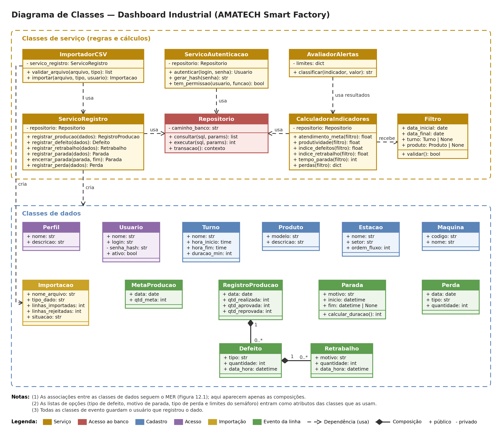

**Figura 5.1 — Diagrama de Classes.** As setas tracejadas indicam dependência ("usa", "cria", "recebe"); os losangos preenchidos indicam composição. As associações entre as classes de dados seguem o MER (Figura 3.1) e foram omitidas para facilitar a leitura.

### 5.1 Classes de serviço

| Classe | Responsabilidade | Principais métodos | Requisitos |
| --- | --- | --- | --- |
| ServicoAutenticacao | Verificar login e permissões do perfil | autenticar(login, senha), gerar\_hash(senha), tem\_permissao(usuario, funcao) | RF18, RF19, RNF07 |
| ServicoRegistro | Validar e gravar os eventos da linha | registrar\_producao, registrar\_defeito, registrar\_retrabalho, registrar\_parada, encerrar\_parada, registrar\_perda | RF01–RF05, RF15 |
| ImportadorCSV | Ler, validar e importar planilhas, gravando tudo ou nada | validar\_arquivo(arquivo, tipo), importar(arquivo, tipo, usuario) | RF16, RN06 |
| CalculadoraIndicadores | Calcular os seis indicadores de um período | atendimento\_meta, produtividade, indice\_defeitos, indice\_retrabalho, tempo\_parada, perdas (todos recebem um filtro) | RF06–RF09, RF15 |
| AvaliadorAlertas | Definir a cor do semáforo de cada indicador | classificar(indicador, valor): verde, amarelo ou vermelho | RF17, RN08 |
| Filtro | Guardar o período, o turno e o produto escolhidos | validar() | RF12, RN05 |
| Repositorio | Única classe que executa SQL no banco | consultar(sql, params), executar(sql, params), transacao() | RNF04, RNF05 |

### 5.2 Classes de dados

Cada classe segue uma tabela do MER, com nomes no padrão do Python. No lugar das chaves estrangeiras, a classe guarda o objeto relacionado: por exemplo, RegistroProducao tem um atributo turno do tipo Turno.

| Classe | Principais atributos | Método |
| --- | --- | --- |
| Perfil | nome, descricao | — |
| Usuario | nome, login, senha\_hash (privado), ativo | — |
| Turno | nome, hora\_inicio, hora\_fim, duracao\_min | — |
| Produto | modelo, descricao | — |
| Estacao | nome, setor, ordem\_fluxo | — |
| Maquina | codigo, nome | — |
| MetaProducao | data, qtd\_meta | — |
| RegistroProducao | data, qtd\_realizada, qtd\_aprovada, qtd\_reprovada | — |
| Defeito | tipo, quantidade, data\_hora | — |
| Retrabalho | motivo, quantidade, data\_hora | — |
| Parada | motivo, inicio, fim (vazio se em andamento) | calcular\_duracao(): minutos |
| Perda | data, tipo, quantidade | — |
| Importacao | nome\_arquivo, tipo\_dado, linhas\_importadas, linhas\_rejeitadas, situacao | — |

As listas de opções do MER (tipo de defeito, motivo de parada, tipo de perda e limites do semáforo) aparecem como atributos das classes que as usam, e não como classes próprias.

### 5.3 Relações

| De | Para | Tipo | Significado |
| --- | --- | --- | --- |
| ServicoAutenticacao, ServicoRegistro, CalculadoraIndicadores | Repositorio | Dependência (usa) | Toda leitura e gravação no banco passa pelo Repositorio |
| ImportadorCSV | ServicoRegistro | Dependência (usa) | Cada linha da planilha passa pelas mesmas validações do formulário |
| ImportadorCSV | Importacao | Dependência (cria) | Cada envio de planilha gera um registro de importação |
| ServicoRegistro | Classes de dados | Dependência (cria) | Os eventos são criados depois de validados |
| CalculadoraIndicadores | Filtro | Dependência (recebe) | Todo cálculo é feito para um período (RN05) |
| AvaliadorAlertas | CalculadoraIndicadores | Dependência (usa resultados) | As cores são definidas a partir dos valores calculados |
| RegistroProducao | Defeito | Composição (1 para 0..\*) | Um defeito só existe dentro de um registro de produção |
| Defeito | Retrabalho | Composição (1 para 0..\*) | Um retrabalho só existe a partir de um defeito |

### 5.4 Regras garantidas pelas classes de serviço

| Regra | Onde é aplicada | Como |
| --- | --- | --- |
| RN03 | CalculadoraIndicadores | Sem meta cadastrada, o atendimento retorna "sem meta", sem divisão por zero |
| RN05 | Filtro e CalculadoraIndicadores | Todo indicador é calculado para um período, nunca de forma acumulada |
| RN06 | ImportadorCSV e Repositorio | A importação roda dentro de uma transação: uma linha inválida desfaz tudo |
| RN08 | AvaliadorAlertas | Os limites são lidos da tabela parametro\_alerta, e não fixados no código |
| RNF07 | ServicoAutenticacao | A senha é transformada em hash antes de ser gravada ou comparada |

## 6. Fluxo do sistema

O fluxo do sistema detalha o processo TO-BE da OA1 do ponto de vista do software: 12 passos em 4 fases, com 4 decisões, distribuídos em três raias de responsabilidade. A raia do meio concentra tudo o que passa a ser automático, no lugar da consolidação manual descrita no AS-IS.

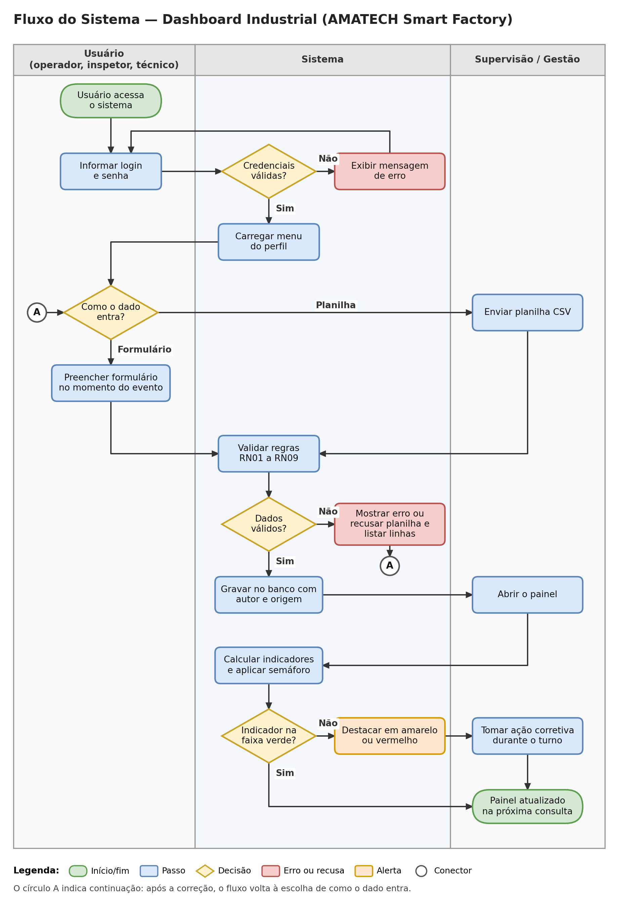

**Figura 6.1 — Fluxo do sistema.** Raias: Usuário (operador, inspetor e técnico), Sistema e Supervisão/Gestão. O círculo A é um conector: após a correção de um dado inválido, o fluxo volta à escolha de como o dado entra.

### 6.1 Fases e passos

| Fase | Passo | Raia |
| --- | --- | --- |
| 1. Entrada no sistema | 1. Acessar o sistema e informar login e senha | Usuário |
|  | 2. Decisão: credenciais válidas? Se não, mensagem de erro e volta ao passo 1 | Sistema |
|  | 3. Carregar o menu com as funções do perfil | Sistema |
| 2. Entrada dos dados | 4. Decisão: como o dado entra? Formulário (no momento do evento) ou planilha CSV (enviada pelo supervisor) | Usuário / Supervisão |
| 3. Validação e gravação | 5. Conferir o dado com as regras RN01 a RN09 | Sistema |
|  | 6. Decisão: dados válidos? Se não, o formulário mostra o erro, ou a planilha inteira é recusada com a lista das linhas com problema; volta ao passo 4 | Sistema |
|  | 7. Gravar no banco com o autor e a origem (formulário ou planilha) | Sistema |
| 4. Painel e decisão | 8. Abrir o painel | Supervisão |
|  | 9. Calcular os indicadores do período e aplicar as cores do semáforo | Sistema |
|  | 10. Decisão: o indicador está na faixa verde? Se sim, o fluxo termina | Sistema |
|  | 11. Destacar o indicador em amarelo ou vermelho | Sistema |
|  | 12. Tomar a ação corretiva durante o turno; os novos registros atualizam o painel na próxima consulta | Supervisão |

### 6.2 Ligação com a OA1

| OA1 (TO-BE) | Fluxo do sistema |
| --- | --- |
| Elemento 04: registro do evento diretamente no sistema | Passo 4, com a opção de formulário ou planilha |
| Elemento 05: armazenamento centralizado em banco único | Passos 5 a 7, com validação antes de gravar |
| Elementos 09 e 10: cálculo automático e exibição no painel | Passos 8 e 9 |
| Elemento 12: indicador fora do esperado? | Passo 10, com os limites do semáforo |
| Elemento 13: ação corretiva antecipada | Passo 12, ainda durante o turno |

A principal diferença em relação ao AS-IS é o momento em que a informação fica disponível: os indicadores podem ser consultados desde o início do turno, e não apenas após o seu encerramento.

## 7. Arquitetura

O sistema usa uma arquitetura em quatro camadas, com uma regra central: cada camada só conversa com a camada logo abaixo dela. Todas as tecnologias são gratuitas (RNF06), e o sistema roda em um computador da fábrica, acessado pelo navegador.


**Figura 7.1 — Arquitetura em camadas.** As planilhas CSV entram pela tela de Importação. A coluna "modelos/" reúne as 13 classes de dados, usadas pelas camadas 1 a 3.

### 7.1 Camadas

| Camada | Conteúdo | Responsabilidade | O que não faz |
| --- | --- | --- | --- |
| 1. Apresentação | As 10 telas do sistema | Receber o que o usuário digita ou envia e mostrar os resultados | Não calcula indicadores nem acessa o banco |
| 2. Serviços | As 6 classes de serviço (seção 5.1) | Aplicar as regras de negócio e calcular os indicadores | Não escreve SQL |
| 3. Acesso a dados | Repositorio | Executar as consultas e gravações, com transações | Não decide regras de negócio |
| 4. Dados | Arquivo banco.db (SQLite) | Guardar as 17 tabelas do MER e garantir as restrições | Não guarda indicadores calculados |

As fórmulas dos indicadores ficam na camada 2, na CalculadoraIndicadores, e não no banco. Assim, todas as regras ficam no mesmo lugar do código, são mais fáceis de testar e de explicar, e o banco guarda apenas dados brutos.

### 7.2 Tecnologias

| Camada | Tecnologia | Para que serve |
| --- | --- | --- |
| Todas | Python 3.11 ou superior | Linguagem única do projeto |
| 1. Apresentação | Streamlit | Telas, formulários, envio de arquivos e navegação |
| 1. Apresentação | Plotly | Gráficos interativos do painel |
| 2. Serviços | pandas | Leitura das planilhas CSV e agrupamento dos dados para os cálculos |
| 2. Serviços | hashlib (biblioteca padrão do Python) | Proteção das senhas com hash e "sal" (RNF07) |
| 3. Acesso a dados | sqlite3 (biblioteca padrão do Python) | Conexão com o banco |
| 4. Dados | SQLite | Banco em um único arquivo, sem servidor |
| Apoio | VS Code, GitHub, Trello, Draw.io, Figma | Código, versões, tarefas, diagramas e wireframes |

### 7.3 Escolha da interface

A equipe comparou o Streamlit com o Flask (com HTML, CSS e JavaScript) e escolheu o **Streamlit**.

| Critério | Streamlit | Flask + HTML/CSS/JS |
| --- | --- | --- |
| Linguagens | Apenas Python | Python, HTML, CSS e JavaScript |
| Importação de CSV (RF16) | Componente de envio de arquivo pronto | Formulário e rota próprios |
| Gráficos e semáforo (RF11, RF17) | Gráficos e cartões de indicador prontos | Biblioteca de gráficos e estilos próprios |
| Navegação (RF14) | Cada arquivo da pasta pages vira uma tela no menu | Rotas e menu programados à mão |
| Esforço na OA3 | Menor | Maior, concentrado na interface |

Como as camadas 2 a 4 não dependem da interface, uma eventual troca do Streamlit no futuro afetaria apenas a camada 1.

### 7.4 Execução

Um computador executa o comando `streamlit run app.py`, e o sistema abre no navegador. Os demais computadores da mesma rede acessam o sistema pelo endereço desse computador, o que atende ao uso nos dois turnos (RNF03). O banco pode ser recriado a qualquer momento a partir do script SQL.

### 7.5 Estrutura de pastas

Cada pasta corresponde a uma camada, para que a arquitetura apareça no próprio código.

```
Projeto_AMATECH/
├── app.py              ← camada 1: tela de login (entrada do sistema)
├── pages/              ← camada 1: as demais telas (painel, produção, qualidade...)
├── servicos/           ← camada 2: autenticação, registro, importação, calculadora, alertas, filtro
├── modelos/            ← as 13 classes de dados
├── acesso_dados/       ← camada 3: repositorio.py
├── database/           ← camada 4: script SQL, arquivo do banco e modelos de planilha CSV
├── testes/             ← testes das fórmulas e das regras
├── docs/               ← relatório, diagramas e wireframes
├── requirements.txt    ← lista de bibliotecas para instalar
└── README.md           ← instruções de instalação e uso
```

## 8. Wireframes finais

O sistema tem 10 telas, desenhadas em média fidelidade: tons de cinza, com cores apenas no semáforo e nas mensagens de sucesso e erro. Todas usam apenas recursos que o Streamlit oferece, para que o sistema construído na OA3 fique igual aos desenhos. Como a OA1 não teve wireframes, estes foram criados do zero nesta etapa.

### 8.1 Layout padrão

Exceto o login, todas as telas têm duas áreas:

- **Menu lateral:** nome do sistema, usuário logado com o perfil, lista das telas que **aquele perfil** pode acessar e botão "Sair". O menu atende ao RF14 (navegação) e ao RNF07 (cada perfil acessa apenas o que pode).
- **Área principal:** título da tela, filtros quando houver, mensagens em faixas coloridas e o conteúdo (formulário, tabela ou gráficos).

Nas telas de registro, a data de hoje e o turno atual vêm preenchidos pelo relógio do computador e podem ser alterados. Os wireframes usam os dados do exemplo do enunciado, e os valores se conferem entre as telas: os três lançamentos da tela de produção somam os 1.420 notebooks do painel, e os defeitos somam os 60 reprovados. Os nomes das pessoas são fictícios.

| Tela | Perfis | Requisitos |
| --- | --- | --- |
| T01 Login | Todos | RF18 |
| T02 Painel de indicadores | Supervisor, Gestor, Diretoria | RF06–RF12, RF17 |
| T03 Produção e metas | Operador, Supervisor | RF01, RF02 |
| T04 Qualidade | Operador, Inspetor, Supervisor | RF03, RF04 |
| T05 Paradas | Manutenção, Supervisor | RF05 |
| T06 Perdas | Supervisor | RF15 |
| T07 Importação de planilhas | Supervisor | RF16 |
| T08 Histórico | Supervisor, Gestor, Diretoria | RF13 |
| T09 Cadastros | Administrador (Supervisor só nos limites do semáforo) | RF17, RN08 |
| T10 Usuários | Administrador | RF19 |

### 8.2 T01 — Login

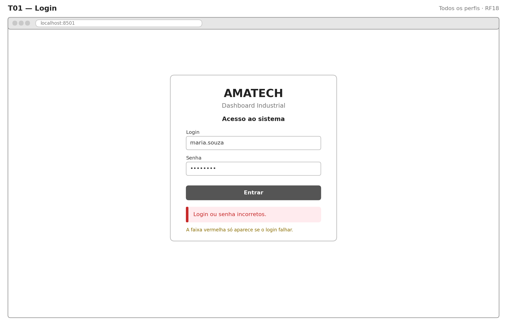

**Figura 8.1 — Login.** Campos de login e senha (oculta) e botão "Entrar". A faixa vermelha "Login ou senha incorretos" aparece só quando o acesso falha. Não há opção de recuperar a senha: quem redefine senhas é o Administrador, na tela T10.

### 8.3 T02 — Painel de indicadores

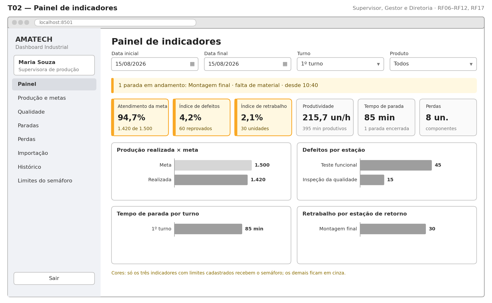

**Figura 8.2 — Painel de indicadores.** É a tela principal. Os filtros de data, turno e produto abrem com o dia e o turno atuais, e os números se atualizam assim que o filtro muda. A faixa amarela avisa as paradas em andamento. Os seis cartões mostram os indicadores; os três com limites (meta, defeitos e retrabalho) recebem a cor do semáforo. Os quatro gráficos cobrem o RF11: produção × meta, defeitos por estação, tempo de parada por turno e retrabalho por estação de retorno.

### 8.4 T03 — Produção e metas

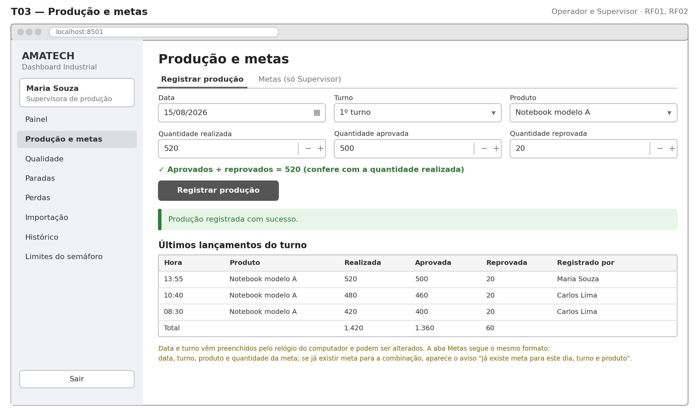

**Figura 8.3 — Produção e metas.** Duas abas. "Registrar produção" pede data, turno, produto e as quantidades realizada, aprovada e reprovada, e confere a soma antes de gravar. "Metas", visível só para o Supervisor, pede data, turno, produto e quantidade, e avisa se já existe meta para a combinação (RN09). Abaixo, a tabela dos últimos lançamentos do turno.

### 8.5 T04 — Qualidade

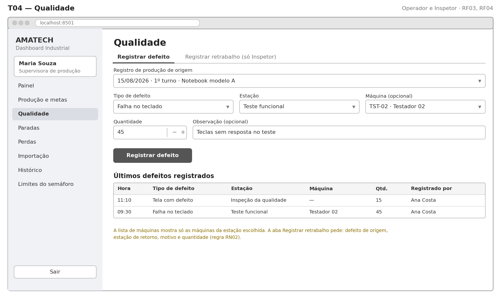

**Figura 8.4 — Qualidade.** Duas abas. "Registrar defeito" pede o registro de produção de origem, o tipo de defeito, a estação, a máquina (opcional, filtrada pela estação), a quantidade e uma observação. "Registrar retrabalho", visível só para o Inspetor e o Supervisor, pede o defeito de origem, a estação de retorno, o motivo e a quantidade (RN02).

### 8.6 T05 — Paradas

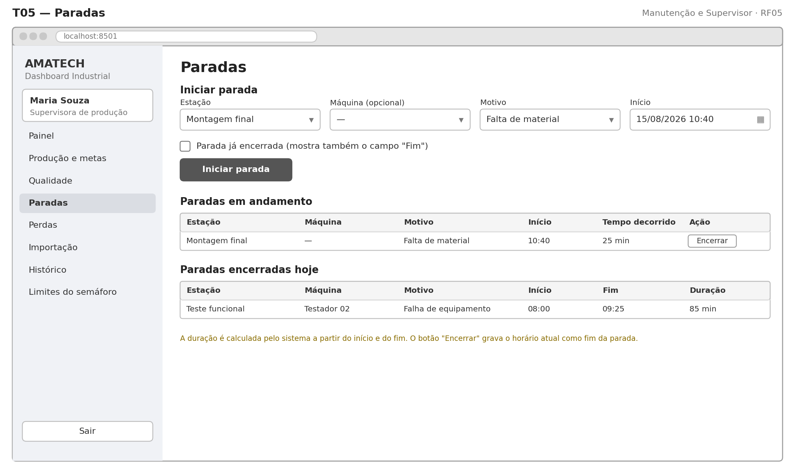

**Figura 8.5 — Paradas.** "Iniciar parada" pede estação, máquina (opcional), motivo (obrigatório) e início, que vem com a hora atual. A opção "Parada já encerrada" mostra também o campo de fim, para paradas lançadas depois. A tabela de paradas em andamento tem o botão "Encerrar" em cada linha, e a de paradas encerradas mostra a duração calculada pelo sistema.

### 8.7 T06 — Perdas

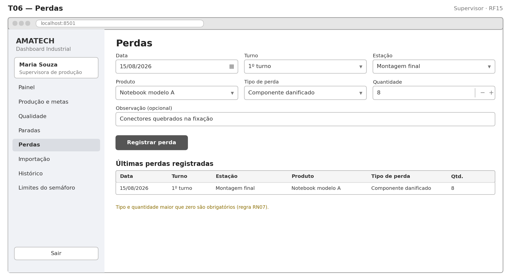

**Figura 8.6 — Perdas.** Formulário com data, turno, estação, produto, tipo de perda, quantidade e observação. Tipo e quantidade maior que zero são obrigatórios (RN07). Abaixo, a tabela das últimas perdas.

### 8.8 T07 — Importação de planilhas

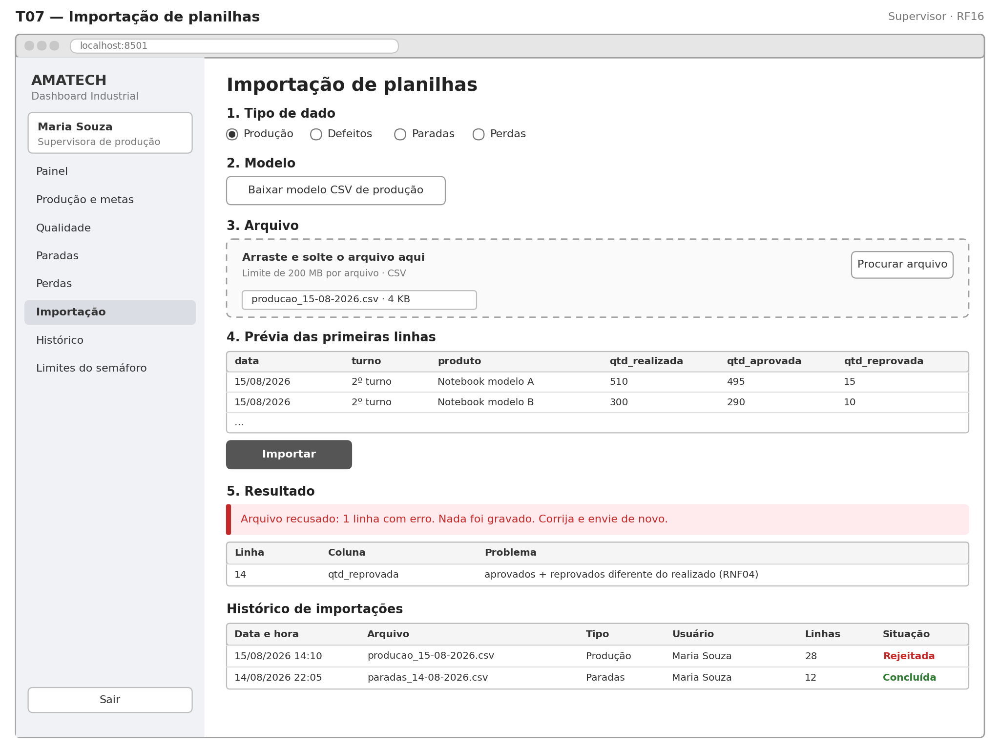

**Figura 8.7 — Importação de planilhas.** Passo a passo em cinco etapas: escolher o tipo de dado, baixar o modelo CSV, enviar o arquivo, conferir a prévia e ver o resultado. No exemplo, o arquivo foi recusado por uma linha com erro, e a tabela mostra linha, coluna e problema; nada foi gravado (RN06). No fim, o histórico de importações.

### 8.9 T08 — Histórico

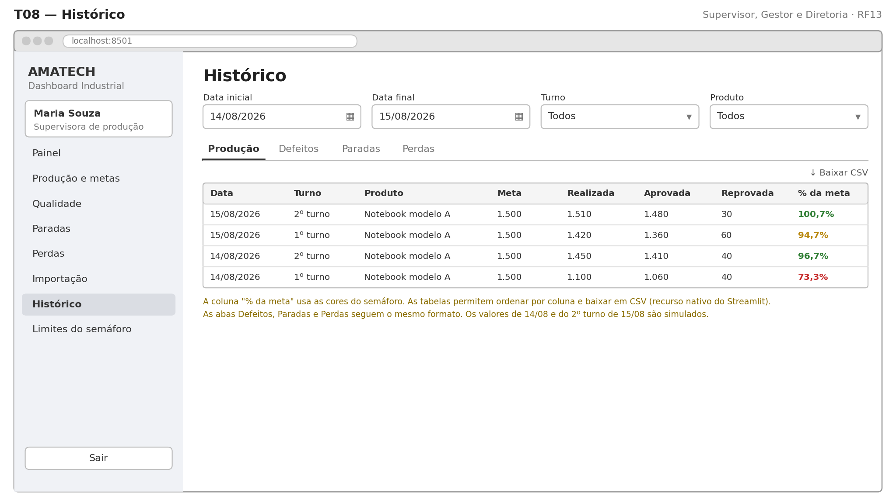

**Figura 8.8 — Histórico.** Os mesmos filtros do painel e quatro abas (Produção, Defeitos, Paradas e Perdas). Aqui ficam as tabelas de histórico de produção e de defeitos registrados previstas na OA1. A coluna "% da meta" usa as cores do semáforo, e as tabelas permitem ordenar por coluna e baixar os dados em CSV. Os valores de 14/08 e do 2º turno de 15/08 são simulados.

### 8.10 T09 — Cadastros

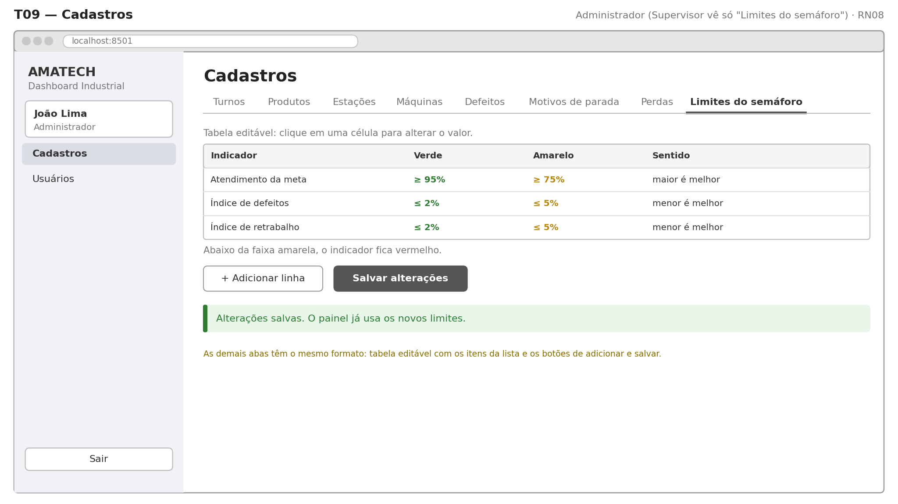

**Figura 8.9 — Cadastros.** Uma aba por lista: turnos, produtos, estações, máquinas, tipos de defeito, motivos de parada, tipos de perda e limites do semáforo. Cada aba é uma tabela editável com os botões "Adicionar linha" e "Salvar alterações". A figura mostra a aba de limites, a única que o Supervisor acessa (UC16).

### 8.11 T10 — Usuários

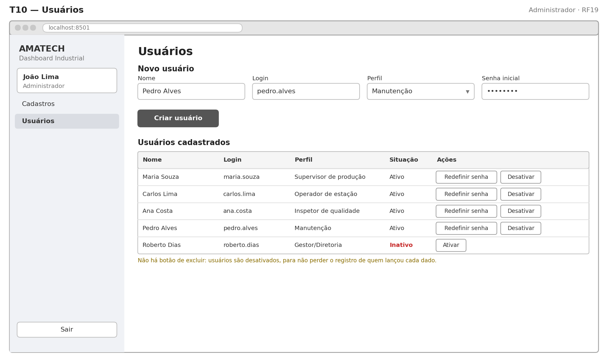

**Figura 8.10 — Usuários.** Formulário para criar usuários (nome, login, perfil e senha inicial) e tabela dos usuários cadastrados, com os botões "Redefinir senha" e "Ativar/Desativar". Não há botão de excluir: usuários são desativados, para não perder o registro de quem lançou cada dado.

## 9. Planejamento do desenvolvimento

A OA3 será desenvolvida em cinco sprints de uma semana, de 01/10 a 04/11/2026, cada uma terminando com uma versão que funciona. A ordem segue as dependências da arquitetura: primeiro a base, depois quem grava dados e, por último, quem lê e calcula.

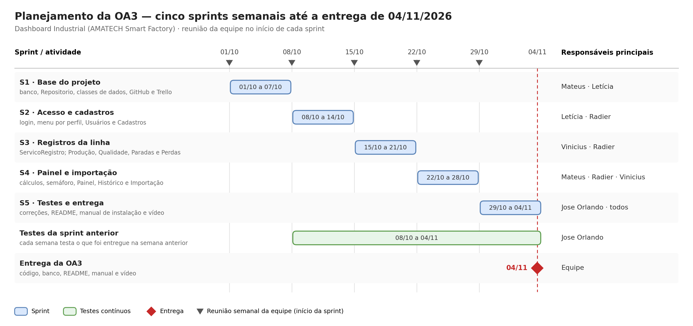

**Figura 9.1 — Planejamento da OA3.** Cinco sprints semanais, testes contínuos a partir da segunda semana, reunião no início de cada sprint e entrega em 04/11.

### 9.1 Cronograma

| Sprint | Período | Foco | Entregas |
| --- | --- | --- | --- |
| S1 | 01/10 a 07/10 | Base do projeto | Repositório no GitHub com a estrutura de pastas; banco criado pelo script SQL; classes de dados; Repositorio; quadro no Trello |
| S2 | 08/10 a 14/10 | Acesso e cadastros | Login (T01), menu por perfil, Usuários (T10) e Cadastros (T09) |
| S3 | 15/10 a 21/10 | Registros da linha | ServicoRegistro; telas de Produção e metas (T03), Qualidade (T04), Paradas (T05) e Perdas (T06) |
| S4 | 22/10 a 28/10 | Painel e importação | CalculadoraIndicadores e AvaliadorAlertas; Painel (T02), Histórico (T08) e Importação (T07) |
| S5 | 29/10 a 04/11 | Testes e entrega | Testes por requisito, correções, README, manual de instalação e vídeo de até 3 minutos |

O Painel, que é o centro do projeto, fica para a S4 porque só mostra resultados quando já existem dados gravados, e os registros só funcionam depois do login e dos cadastros.

### 9.2 Divisão de responsabilidades

Cada integrante mantém o papel definido na OA1 e fica responsável por uma parte da arquitetura.

| Integrante | Papel (OA1) | Parte da arquitetura | Responsabilidades na OA3 |
| --- | --- | --- | --- |
| Letícia | Líder | Coordenação e acesso | Conduz as sprints e o Trello; revisa e junta o código no GitHub; desenvolve o ServicoAutenticacao |
| Vinicius | Analista de Processos | Camada 2 (regras) | ServicoRegistro com as validações RN01 a RN09; ImportadorCSV e modelos de planilha; dados de teste |
| Mateus | Desenvolvedor | Camadas 3 e 4 (dados) | Script SQL e banco; classes de dados; Repositorio; CalculadoraIndicadores e AvaliadorAlertas |
| Radier | Desenvolvedor de Interface | Camada 1 (apresentação) | As 10 telas em Streamlit, o menu por perfil, os gráficos e as cores do semáforo |
| Jose Orlando | Testes e Documentação | Qualidade do projeto | Testes por requisito, evidências, README, manual de instalação e vídeo |

### 9.3 Tarefas por sprint

| Sprint | Letícia | Vinicius | Mateus | Radier | Jose Orlando |
| --- | --- | --- | --- | --- | --- |
| S1 | GitHub, Trello e estrutura de pastas | Dados de teste com os números do enunciado | Script SQL, banco, classes de dados e Repositorio | Layout padrão e menu lateral | Casos de teste a partir da matriz de rastreabilidade |
| S2 | ServicoAutenticacao e perfis | Regras de validação | Consultas de apoio ao login e aos cadastros | T01 Login, T09 Cadastros e T10 Usuários | Testa a base da S1 |
| S3 | Revisão e integração | ServicoRegistro e modelos de planilha CSV | Apoio ao ServicoRegistro no Repositorio | T03, T04, T05 e T06 | Testa o acesso da S2 |
| S4 | Revisão e integração | ImportadorCSV | CalculadoraIndicadores e AvaliadorAlertas | T02 Painel, T08 Histórico e T07 Importação | Testa os registros da S3 |
| S5 | Organização da entrega | Correções | Correções | Correções | Testes finais, README, manual e vídeo |

### 9.4 Riscos e respostas

| Risco | O que pode acontecer | Resposta planejada |
| --- | --- | --- |
| Conflitos no GitHub | Um integrante sobrescreve o trabalho de outro | Um ramo (branch) por funcionalidade; a líder revisa antes de juntar ao ramo principal |
| Integrante indisponível | Tarefas paradas | Tarefas pequenas no Trello, redistribuídas na reunião semanal |
| Dados de teste incoerentes | Indicadores estranhos na apresentação | Um único conjunto de dados com os números do enunciado, os mesmos dos wireframes |
| Perda do arquivo do banco | Perder o banco com os dados de teste | O banco é recriado a qualquer momento pelo script SQL e pelos dados de teste guardados no GitHub |

### 9.5 Rotina da equipe

- **Reunião semanal** no início de cada sprint, para dividir as tarefas da semana e revisar o que foi entregue.
- **Trello** com as colunas A fazer, Em andamento, Em teste e Concluído; cada cartão indica o requisito que atende (por exemplo, "RF05 · Tela de Paradas").
- **GitHub** com o ramo principal sempre funcionando: nada entra nele sem a revisão da líder.
- **Canal de mensagens** (WhatsApp ou Discord) para dúvidas rápidas entre as reuniões.

## 10. Matriz de rastreabilidade

Os 19 requisitos funcionais estão ligados a um caso de uso, a pelo menos uma tabela ou classe e a uma tela. A matriz também serve de roteiro para os casos de teste da OA3: cada linha vira pelo menos um teste.

| Requisito | Caso de uso | Tabelas e classes | Tela |
| --- | --- | --- | --- |
| RF01 Cadastrar produção | UC05 | registro\_producao; ServicoRegistro | T03 |
| RF02 Cadastrar meta | UC04 | meta\_producao; ServicoRegistro | T03 |
| RF03 Cadastrar defeitos | UC06 | defeito, tipo\_defeito, estacao; ServicoRegistro | T04 |
| RF04 Cadastrar retrabalho | UC07 | retrabalho; ServicoRegistro | T04 |
| RF05 Cadastrar paradas | UC08 | parada, motivo\_parada; ServicoRegistro | T05 |
| RF06 Atendimento à meta | UC12 | meta\_producao, registro\_producao; CalculadoraIndicadores | T02 |
| RF07 Índice de defeitos | UC12 | registro\_producao; CalculadoraIndicadores | T02 |
| RF08 Índice de retrabalho | UC12 | retrabalho, registro\_producao; CalculadoraIndicadores | T02 |
| RF09 Tempo de parada | UC12 | parada; CalculadoraIndicadores | T02 |
| RF10 Painel único | UC11 | CalculadoraIndicadores | T02 |
| RF11 Gráficos | UC11 | CalculadoraIndicadores | T02 |
| RF12 Filtros | UC14 | Filtro | T02, T08 |
| RF13 Histórico | UC15 | Todas as tabelas de evento | T08 |
| RF14 Navegação | Transversal | perfil; ServicoAutenticacao | Menu lateral de todas as telas |
| RF15 Cadastrar perdas | UC09 | perda, tipo\_perda; ServicoRegistro | T06 |
| RF16 Importar CSV | UC10 | importacao e tabelas de evento; ImportadorCSV | T07 |
| RF17 Alerta visual | UC13, UC16 | parametro\_alerta; AvaliadorAlertas | T02, T09 |
| RF18 Autenticar | UC01 | usuario; ServicoAutenticacao | T01 |
| RF19 Gerenciar usuários | UC02 | usuario, perfil; ServicoAutenticacao | T10 |

Os cadastros básicos que apoiam os registros (turnos, produtos, estações, máquinas e tipos) são mantidos pelo UC03, na tela T09. A produtividade, indicador ajustado na seção 2.4, é calculada pela CalculadoraIndicadores e exibida na T02.

## 11. Considerações da etapa

A OA2 respondeu como o Dashboard Industrial vai resolver o Problema 8: um banco único de 17 tabelas, alimentado por formulários e planilhas, com seis indicadores calculados na consulta e um painel com semáforo. As decisões mais importantes foram a revisão dos requisitos (RF15 a RF19), a correção da fórmula de produtividade, a meta por turno e a arquitetura em quatro camadas com Streamlit.

A coerência entre os entregáveis foi verificada ao longo das etapas: os requisitos aparecem nos casos de uso, nas tabelas e nas telas (seção 10), e os números do exemplo do enunciado se repetem do banco até os wireframes.

### 11.1 Arquivos entregues

| Entregável | Arquivos |
| --- | --- |
| MER | mer\_dashboard\_industrial.png e .drawio |
| Diagrama de Casos de Uso | casos\_de\_uso\_dashboard.png e .drawio |
| Diagrama de Classes | classes\_dashboard.png e .drawio |
| Fluxo do sistema | fluxo\_sistema\_dashboard.png e .drawio |
| Documento de arquitetura | Seção 7 deste relatório; arquitetura\_dashboard.png e .drawio |
| Wireframes finais | wireframe\_T01 a wireframe\_T10 (.png) e wireframes\_dashboard.drawio (10 páginas) |
| Planejamento do desenvolvimento | Seção 9 deste relatório; planejamento\_oa3\_gantt.png |
| Banco de dados | banco\_dashboard\_industrial.sql |
| Apresentação | Slides da OA2 (14 slides) |

### 11.2 Pendências antes da entrega

- [x] Atualizar o script SQL com as decisões desta etapa: limite vermelho da meta abaixo de 75%, retirada das views de indicadores (as fórmulas passaram para a CalculadoraIndicadores) e descrição do perfil Supervisor com acesso aos limites do semáforo
- [ ] Preencher o nome do professor na capa
- [ ] Exportar o relatório em PDF para a entrega

## 12. Referências

FUNDAÇÃO MATIAS MACHLINE. **Projeto Integrador AMATECH Smart Factory**: enunciado da disciplina Ambiente Fabril I. Manaus, 2026.

EQUIPE DO PROJETO 3. **Dashboard Industrial**: relatório da OA1 (diagnóstico e requisitos). Manaus, 2026.

PYTHON SOFTWARE FOUNDATION. **sqlite3: DB-API 2.0 interface for SQLite databases**. Disponível em: https://docs.python.org/3/library/sqlite3.html.

SQLITE. **SQLite Documentation**. Disponível em: https://www.sqlite.org/docs.html.

STREAMLIT. **Streamlit Documentation**. Disponível em: https://docs.streamlit.io.

DRAW.IO. **diagrams.net**. Disponível em: https://www.drawio.com.
